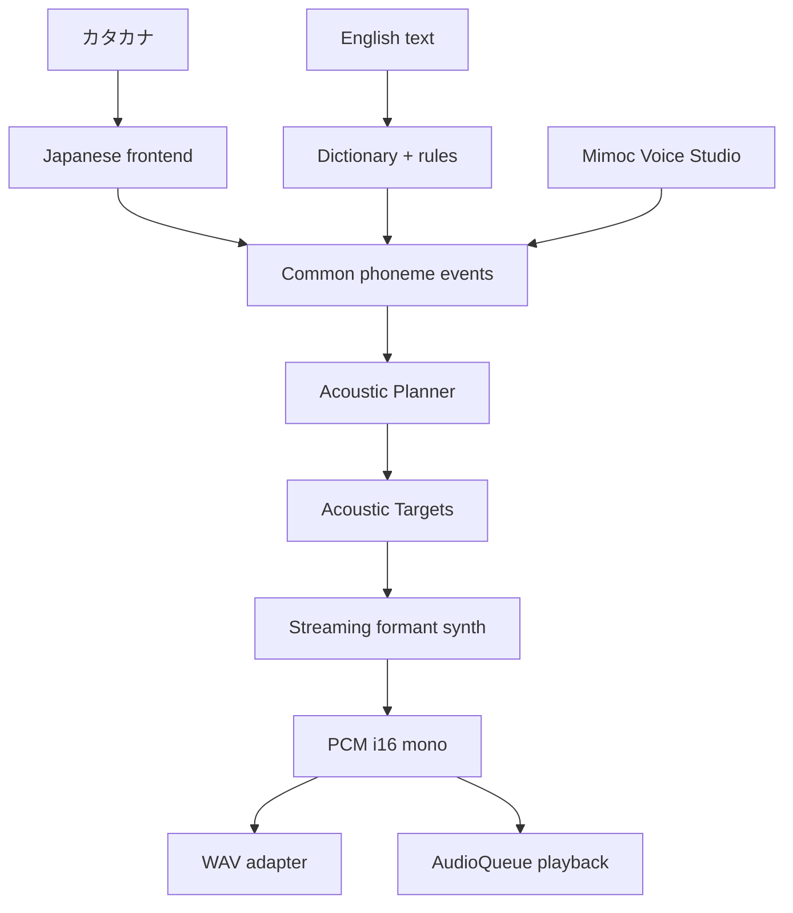
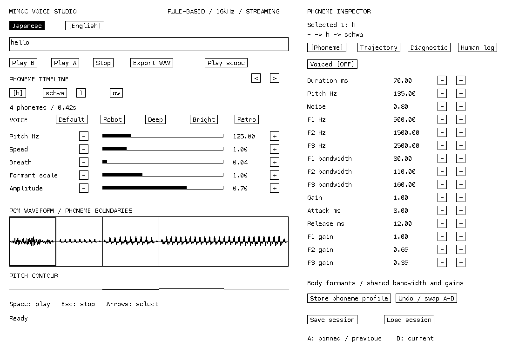

# mimoc-voice

## What is mimoc-voice?

Zig 0.17で実装した、小型・組み込み向けの日英ルールベース音声合成器です。
日本語はカタカナ、英語は小さな例外辞書とletter-to-phoneme規則を使用します。
Phase 6で聞き取り問題の切り分け用Planner・診断scope・blind A/B・人手評価ログを追加しました。
ニューラルネットワーク、録音音声、外部音声データは使用しません。
DECtalkや1980年代の電子音声のような、特徴のある人工音声を育てるためのシンセサイザーです。

## Philosophy

**small / deterministic / portable / embedded-friendly / hackable** を重視します。
自然さより、言葉の明瞭さ、小ささ、移植しやすさ、パラメータ調整のしやすさを優先します。
現在の音色は初期チューニングです。人間による聞き取り評価はまだ完了していません。

## Architecture



- `src/core`: 音素・イベント・声質、声帯音源、noise、3共振器、envelope、Synth。
  filesystem、audio device、thread、UI、allocatorに依存しません。
- `src/planner`: language、stress、neighborからduration・動的formant・transition・source shapingを計画します。
- `src/lang`: UTF-8カタカナ、英語のtokenizer・辞書・規則。出力方法を知りません。
- `src/audio`: bounded chunkでのWAV保存、macOS CoreAudioストリーミング再生。
- `src/studio`: 既存mimoc-uiのUIと共通coreを使う編集モデル。
- `src/root.zig`: CLI・Studio・組み込み用の共通library API。

## Usage

Zig **0.17.0** が必要です。Studioは既存mimoc-ui checkoutを使用します。
デフォルト位置は `../mimoc-ui`、別の場所なら `-Dmimoc-ui=/path/to/mimoc-ui` を指定します。
外部パッケージの自動downloadはありません。

```sh
zig build
./zig-out/bin/mimoc-voice synth --lang ja "コンニチワ" -o hello-ja.wav
./zig-out/bin/mimoc-voice synth --lang en "hello world" -o hello-en.wav
./zig-out/bin/mimoc-voice play --lang ja "オハヨウ"
zig build run -- synth-phoneme a -o a.wav
zig build run -- synth --lang en "system ready" --preset Retro --rate 22050 -o ready.wav
zig build studio
```

`-o` の省略時は `voice.wav` に保存します。PCMはsigned 16-bit mono、既定16kHz、8〜96kHzで設定可能です。
CLIのWAV出力はmacOS/Linuxで利用可能です。現在の再生・StudioバックエンドはmacOSです。
ESP32-S3/I2S実装、fixed-point DSPは今回の範囲外です。

## Voice Studio



- Japanese / Englishを選び、文字を入力すると音素列と波形を更新します。
- **Play B**: 現在、**Play A**: Pin Aした状態（未pin時は直前の編集前）、**Stop**: 再生停止。
- タイムラインの音素を選び、DiagnosticのscopeをSelectedにして**Play scope**で単独試聴します。
  `<` / `>`で8音素ずつページ移動できます。
- Voiceの棒はdrag可能です。`−` / `+`でもpitch、speed、breath、formant scale、amplitudeを変更できます。
- Inspectorの`−` / `+`でduration、pitch、noise、F1/F2/F3、各bandwidth・gain、全体gain、attack/releaseを調整します。
  Voicedボタンで有声・無声を切り替えます。
- **Store phoneme profile**で選択音素の音色を保存すると、次のテキスト変換から同じ音素へ適用します。
  duration/pitchはそのイベントだけの設定です。
- Default / Robot / Deep / Bright / Retroを切り替え、**Undo / swap A-B**で比較できます。
- **Export WAV**は保存dialogで場所を選び、現在の編集内容を出力します。
- **Save session / Load session**は作業directoryの`voice-session.json`にテキスト、voice、音素イベント、編集済みtarget、音素profile、評価snapshot、blind trialを保存・復元します。
  通常のテキスト再変換でイベント個別の編集は置き換わります。
- テキスト編集外でSpaceは再生、Escは停止、左右キーは音素選択。入力欄のEnterも試聴します。
- PCM waveform、音素境界、pitch contourを表示します。FFT/spectrogramは未実装です。

mimoc-uiの既存text field、button、progress、runtime、Mono1 renderer、macOS window/fontを組み合わせています。
Voice Studio用のslider操作とgraph描画はアプリ側に置き、mimoc-uiへの専用機能追加は行っていません。

## Library / streaming

Build module名は`mimoc_voice`です。

```zig
const v = @import("mimoc_voice");
var events: [128]v.event.PhonemeEvent = undefined;
const sequence = try v.japanese.parse("コンニチワ", &events);
var synth = try v.synth.Synth.init(.{ .sample_rate = 16000 });
var targets: [128]v.target.AcousticTarget = undefined;
const planned = try v.planner.plan(sequence.events(), &targets, .{ .language = .ja });
try synth.enqueue(planned);
var pcm: [256]i16 = undefined;
while (!synth.finished()) {
    const n = synth.render(&pcm);
    // pcm[0..n]をI2S、audio callback、WAV adapter等へ渡す。
}
```

SynthはAcousticTarget列を借用します。再生が終了するまで、そのmemoryを保持し内容を変更しないでください。
同一Synthのenqueue/renderを並行して呼ばないでください。busy中のenqueueはerrorになります。
`render`は任意buffer長（0も可）に対応し、終端で0を返します。最終chunkはbufferより短い場合があります。
core・frontendともにcaller-owned固定bufferで利用できます。frontendの容量不足・invalid UTF-8はerrorです。
単一イベントのpitchを0にすると、voiceのbase pitchと相対contourを使用します。
同じbuild/config/targetsでbufferの分割方法によらず同じPCMを生成します。
CPU・浮動小数点implementationが異なる環境間のbit一致は保証しません。

## Language coverage

日本語: 五十音、濁音、半濁音、拗音、ッ、ー、ン、ヴ、小書き母音。
1モーラは基本140ms、拗音も140ms、ッは140msのclosure、ーは前の母音へ140ms加算します。
ンは独立した鼻音`N`です。母音以外へ続くーは`InvalidLongMark`を返します。
spaceは短い休止、句読点は長めの休止、未対応文字は件数を報告して休止へ変換します。
漢字・ひらがな・半角カタカナ・外来語拡張の全組み合わせには対応していません。

英語: case-insensitive tokenizer、space、punctuation、apostrophe、36語の小辞書（診断語を含む）。
未知語は`pattern/context/replacement`テーブルと文字規則で読みます。
英語母音11種とdiphthong5種を独立して扱い、`hello`は`h schwa l ow`です。stress・弱化は初期規則として実装され、辞書外の正確な発音は保証しません。
疑問終端ではpitchを上げます。文章内の自然なaccent解析は行いません。

## Validation and benchmark

```sh
zig build test
zig build test-studio        # macOS: 音声デバイスを使用し指定6フレーズを再生
zig build check-studio
zig build check-embedded     # RV32 freestanding core compile smoke
zig build bench -Doptimize=fast
python3 tools/evaluate.py    # 日英diagnostic corpus + 35 A/B contrasts / 136 WAVs
```

DSP・frontend・WAV header、streaming、exact frames、partial buffers、EOS、determinism、異常入力、全音素・preset・複数sample rateを検証します。
評価フレーズのPCMはDC偏り、ピーク、隣接sample差、非有限内部値も確認します。
Studioテストは実際の入力・pointer操作・CoreAudio再生・WAV export・A/B・sessionを通します。
合成coreはheap allocationを行いません。benchmarkは10秒相当の日本語音声を160,000 frames生成し、処理時間・throughput・Synthサイズ・PCM bufferサイズを報告します。
表示するpeak heap allocation **0 bytesはSynthの範囲**です。Zig起動処理、OS audio、mimoc-ui、JSON保存のプロセス全体のheap使用量は含みません。

検証結果・人手試聴手順は[docs/validation.md](docs/validation.md)を参照してください。

## Phase 6 — intelligibility diagnostics

[仮説・構造・評価手順](docs/intelligibility.md)を参照してください。聞き取り改善の採否は人手評価待ちです。

```sh
zig build run -- synth --lang en "hello" -o hello.wav --targets hello.json
zig build run -- synth --lang en "hello" --scope selected_next --selected 2 -o l-ow.wav
zig build run -- render-targets hello.json -o exact-replay.wav
python3 tools/evaluate.py --output zig-out/evaluation
python3 tools/replay_evaluation.py voice-session.json --record 1 -o record.wav
python3 tools/replay_evaluation.py voice-session.json --comparison 1 --side B -o blind-B.wav
```

Studioの**Trajectory**で開始/終了formant・pitch・amplitude・voicing・transitionを編集できます。
**Diagnostic**で再生scope、single/double envelope、Pin A、blind X/Y比較を選びます。
**Human log**でscore・聞こえた内容・問題・単一仮説・keep/revert/pendingを記録し、Save sessionで保存します。
セッションv2は編集済みtargetとimmutable評価snapshotを保持し、旧v1も読み込み可能です。
各trialでは両音声を最後まで再生してからX/Y/Sameへ投票します。Revealまで勝敗集計を隠します。
旧Phase 5は`--reference phase5`、envelopeだけ除去した旧音響系は`--reference envelope_single`でWAVを再生成できます。
これらは診断専用で、組み込みSynthの依存には含まれません。
