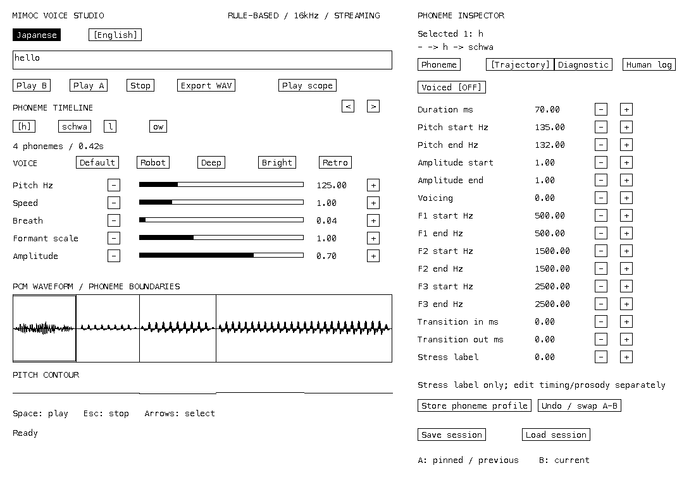
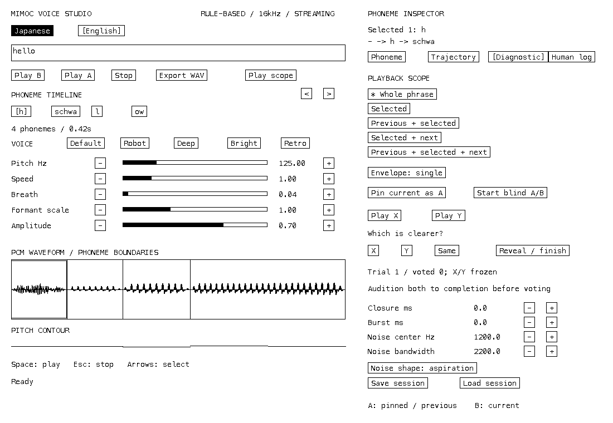

# Phase 6: intelligibilityを検証する環境

音声の聞き取り改善は未判定です。自動検査は信号異常と実装回帰を検出し、採用・却下は人間の聴覚評価で決めます。評価ログのテスト用スコアは人手評価ではありません。

## 改善前と改善後

Phase 5では`Text → PhonemeEvent → Synth → PCM`でした。Synth内に音素テーブル、隣接音素による補間、25msの共通transitionがあり、英語は母音110ms・子音60ms、helloは`h eh l o`でした。

現在の構造:

```text
Text → language frontend → PhonemeEvent[]
                               ↓
                 Acoustic Planner (language/context/stress)
                               ↓
                  caller-owned AcousticTarget[]
                               ↓
                    Synth.render(i16 buffer) → PCM
```

Synthは言語・辞書・音素別の発音ルールを参照しません。音素IDは診断用metadataです。PlannerもOS/UI/heapに依存せず、呼び出し元のtarget bufferへ書き込みます。CLIとStudioは同じPlanner/Synthを使います。Studioのtarget編集後は再planせず、編集済みtargetを直接合成します。

## 仮説と切り分け

| 仮説 | 独立比較 | 確認する対象 |
|---|---|---|
| H01: 二重envelopeが短い音を弱める | single / legacy_double | h、l、hello、コンニチワ。旧DSPを固定した比較も用意 |
| H02: ow等の定常母音では移動cueが欠ける | glide on / off | ey、ay、oy、ow、aw |
| H03: 固定durationでは弱母音・強勢の区別が欠ける | timing context / fixed | hello |
| H04: approximantの隣接formant移動が不足する | transitions context / fixed | l、r、w、yの母音間context |
| H05: 一様noiseでは摩擦音の区別が不足する | noise shaped / legacy | s、sh、f、h、k、t、p |
| H06: 日本語近似母音では英語の対立が潰れる | vowels english / japanese_approx | iy、ih、eh、aa、ao、uh、uw |
| H07: 強勢のpitch/amplitude cueが不足する | stress on / off | hello |

一つの比較では一つのfactorだけを変更します。全変更後とPhase 5の差を、個別の変更の効果とは解釈しません。英語表・transition・noiseの値は検証用初期値で、採用確定の音質チューニング値ではありません。

### Envelope

旧Synthはlimiter/DC処理の前とPCM出力時の二箇所でenvelopeを適用していました。非線形処理を挟むため出力全体が厳密に`env²`とは限りませんが、短い音の抑制要因となる構造です。現在は最終PCM側の一回だけを基本とし、音素端のzeroとDC処理を維持します。

`src/diagnostic/baseline`は元コミット`e17be91cf495c649f73b2dd9a4e32d044c6befe7`のDSP/frontendを凍結しています。`envelope_reference.zig`はこの旧音響系から前段envelopeの乗算だけを除去した比較対象です。`docs/envelope-baseline.json`のWAV SHA-256をmacOS/aarch64上でテストし、以後の母音・辞書・noise変更がbaselineへ混入しないようにしています。500ms単音に加え60msのh/lも生成します。浮動小数点のplatform差をまたぐ同一hashは保証しません。

## hello reference

辞書テストは`h schwa l ow`を固定します。Default、16kHz、speed=1の自動plan:

| 音素 | duration | stress | 主な動作 |
|---|---:|---:|---|
| h | 70ms | 0 | 次のschwaのformantでaspiration noiseを着色 |
| schwa | 70ms | 0 | amplitude 0.65、後続lへの移動 |
| l | 85ms | 0 | 前後母音とのformant transition |
| ow | 195ms | 1 | 170ms基準+強勢15ms+語末10ms、pitch/amplitude強調、glide |

合計420ms、6720 framesです。owのbodyはF1/F2/F3=`450/900/2450Hz`、終了は`350/1100/2450Hz`。開始側はlからのtransitionを含みます。数値の全体はCLIの`--targets` sidecarへ保存されます。今回の[hello target snapshot](hello-targets.json)も保存しています。

## 英語母音とdiphthong

日本語a/i/u/e/oの表を維持し、英語の定常母音を独立したID/初期値にしました。値は調整用seedで、特定話者の測定値を意味しません。

| ID | F1 | F2 | F3 (Hz) |
|---|---:|---:|---:|
| iy | 270 | 2290 | 3010 |
| ih | 390 | 1990 | 2550 |
| eh | 530 | 1840 | 2480 |
| ae | 660 | 1720 | 2410 |
| aa | 730 | 1090 | 2440 |
| ah | 640 | 1190 | 2390 |
| ao | 570 | 840 | 2410 |
| uh | 440 | 1020 | 2240 |
| uw | 300 | 870 | 2240 |
| er | 450 | 1300 | 1700 |
| schwa | 500 | 1500 | 2500 |

ey: eh→ih、ay: aa→ih、oy: ao→ih、ow:上記、aw: aa→uh。targetはstart/body/endの三点を持ちます。transition-inの後、diphthongではbodyからendへ線形移動します。StudioのTrajectoryで開始/終了周波数を編集でき、Store profileはdiphthongの終了点も保存します。bandwidth/gainはPhoneme tabで編集します。

## Timingとtransition

英語自動timingの初期値はschwa70、短母音100、強勢母音135、diphthong170、摩擦音70、approximant85、破裂音50、鼻音80、破擦音80msです。強勢・語末・後続無声破裂音・直前摩擦音で補正します。日本語はfrontendのモーラdurationを維持し、ッ・ーの明示durationも保持します。明示編集したevent durationは再plan時も尊重します。Timing tableはPlanner APIで変更可能です。

approximantでは直前母音の終了点をその音素のbodyへ35%寄せ、approximantの終了点を後続母音へ65%寄せます。hは後続母音で着色します。transitionの初期値はapproximant/母音60–65ms、破裂音20ms、摩擦音30ms、その他25ms。音素の45%以下へclampし、短い音で入口・出口が重なってbodyが消えないようにします。nonglideはstart→body、定常区間、body→end。glideは入口後にbody→endです。

closure/burstはtarget内に明示した時間で進行します。s/zは高域強調、sh/chはband-pass、f/v等は高域noise、hは後続母音を通すaspirationです。これは識別性の仮説を試せる構造であり、子音の最終品質を保証しません。

## 人手評価手順

1. Studioでphrase・presetを選び、Diagnosticでscopeを指定します。Whole、Selected、Previous+selected、Selected+next、三音contextを選べます。選択音素と前後contextも表示されます。
2. **Pin A**でbaselineを保存します。Human logへ単一仮説を記入し、Phoneme/Trajectoryで一つだけ変更します。Stress欄はmetadata編集で、duration/pitch/amplitudeを自動再計算しません。
3. **Start blind**でA/Bのtargetと再生scopeを凍結します。各trialでX/Yを最後まで聴き、X/Y/Sameへ投票します。停止した再生は完了扱いになりません。
4. 複数trial（初期目安5回）を行い、**Reveal**でnew/old/tieを確認します。X/Y割当はtrialごとに変わり、Reveal前は勝敗を表示しません。厳密な統計検定ではありません。
5. Human logで1–5のintelligibility、heard_as、problem、仮説、keep/revert/pendingを記録します。**Record**でparameter snapshot、scope、language、preset、session indexを凍結し、**Save session**でJSONへ保存します。
6. Revertなら対象parameterを戻します。判定ボタンだけで作業parameterを書き換えることはありません。保存済みrecordは後の編集に追従しません。

```sh
zig build studio
python3 tools/replay_evaluation.py voice-session.json --record 1 -o heard.wav
python3 tools/replay_evaluation.py voice-session.json --comparison 1 --side B -o candidate.wav
```

再生は保存済みtarget/voice/envelope/scopeを使用し、最新辞書で再planしません。セッションv2はtarget・評価・blind trialを保存し、v1は読み込み時にplanします。ログは最大256 records、128 comparisons、比較内128 trialsで、上限超過はerrorです。JSON保存・読み込み上限64MiBです。

## 固定コーパスと技術検査

```sh
zig build
python3 tools/evaluate.py --output zig-out/evaluation
python3 tools/evaluate.py --output zig-out/next --against zig-out/evaluation/report.json
```

english/{vowels,cv,words}、japanese/{vowels,cv,phrases}とexperimentsを生成します。通常66 WAVと35対の独立比較70 WAV、合計136 WAV。helloの各単音/隣接pairも含みます。各current WAVにtarget sidecar、report.json/markdownに条件・SHA・異常検査・未評価のhuman decisionを保存します。

peak/RMS/DC offset/隣接delta/ZCR/spectral centroid/duration、音素ごとのRMSを測定します。voiced ratioはtargetの計画値で、PCMからの推定値ではありません。Synthの非有限値counterも検査し、非有限DSP状態はzero sampleへ退避して検出します。clipping・無音音素・過大DC・予期しないframe数をflagし、前reportとの比較はRMS急落・noise増加をflagします。これらのflagは異常候補で、聞き取りの良さのscoreではありません。

検証結果の要約は[intelligibility-metrics.json](intelligibility-metrics.json)を参照してください。`zig build test test-studio check-embedded check-studio`でPlanner/Synth/辞書/旧WAV固定/native UI操作を検証します。benchmarkのallocation 0はSynthの範囲で、UI/JSON/OSを含みません。動的filter係数によるPC処理コストはPhase 5より増えています。ESP32性能は未測定です。

## 未解決と次の仮説

- h/l/r/w/y、k/t/p、s/sh/fの実際の識別性は人手評価待ちです。
- lの側音特性、英語rの低F3、鼻音の反共振、破裂音のplace-specific burstは簡略モデルです。
- 英語L2Pは小規模規則で、未知語の正確な発音は保証しません。stressは辞書か簡単なfallbackです。
- 次の段階の候補は「lのF3だけ」「s/shのnoise中心だけ」「closure長だけ」の変更です。まず単音、次にpair、最後に単語でblind評価してください。
- CPU削減は音響targetの同等性を維持した係数更新頻度の検証から行えます。固定小数点化やESP32最適化は今回の範囲に含めません。




